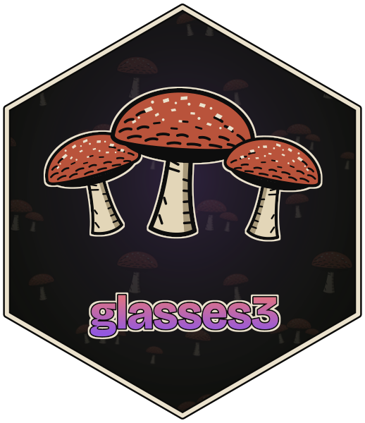

# glasses3 

[](https://github.com/mcanzi/glasses3/actions/workflows/R-CMD-check.yaml)

glasses3 reads recordings from the Tobii Pro Glasses 3 wearable eye tracker into R. It works on the recording folder as it comes off the SD card, so Tobii Pro Lab is not needed.

The glasses store each data stream as gzipped JSON with one record per line (`gazedata.gz`, `imudata.gz` and `eventdata.gz`). glasses3 turns <span class="hl">gaze</span>, <span class="hl">pupil diameter</span>, <span class="hl">IMU</span> and <span class="hl">sync port</span> data into tibbles and reads the recording metadata. Samples are matched to sync port pulses, and the data can be cut into <span class="hl">epochs</span> around pulses, API events or any other stimulus onsets. Plots show pupil diameter over time and gaze position in the scene camera image.

## Installation

glasses3 is not on CRAN yet. Install it from R-universe:

```r
install.packages("glasses3", repos = c("https://mcanzi.r-universe.dev", "https://cloud.r-project.org"))
```

## Usage

```r
library(glasses3)

rec <- read_g3("path/to/recording")
rec
summary(rec)

plot_g3_pupil(rec)
plot_g3_gaze(rec, type = "density")

epochs <- g3_epochs(rec$gaze, rec$events, before = 0.5, after = 5)
plot_g3_pupil(epochs)

trials <- data.frame(onset = c(2, 12, 22), condition = c("a", "b", "a"))
trial_epochs <- g3_epochs(rec$gaze, trials, before = 0.5, after = 5)
pupil <- g3_pupil_long(epochs)
binned <- g3_downsample(pupil, bin = 0.1)

gaze <- g3_gaze_angles(rec$gaze)
gaze <- g3_gaze_velocity(gaze)
gaze <- g3_add_clock_time(gaze, rec)
gaze <- g3_add_frame(gaze)

g3_quality(epochs)
```

The sync port functions use the pulses the glasses receive from other equipment (`direction = "in"`) by default. Epochs can also be cut at <span class="hl">API events</span> from `g3_api_events()` or at any table of onsets, whose other columns are copied to the epochs.

The package comes with a 30-second <span class="hl">example recording</span>, found with `g3_example()`.

### Several recordings

`list_g3_recordings()` finds every recording on an SD card or in any other folder. Pass its output to a reader and you get one tibble for all of them, with a <span class="hl">`recording` column</span> naming the folder each row comes from. The sync port functions match each recording to its own pulses, and the plots get one panel per recording.

```r
recordings <- list_g3_recordings("path/to/sdcard")

gaze <- read_g3_gaze(recordings)
events <- read_g3_events(recordings)

epochs <- g3_epochs(gaze, events, before = 0.5, after = 5)
plot_g3_pupil(gaze, events)
```

The data come back as <span class="hl">tibbles</span>, so they work directly with dplyr and ggplot2, and grouped tibbles keep their groups.

## Scope

glasses3 reads and organises the data. Lines that cannot be read, such as the cut-off end of an incomplete file, are skipped with a warning, and `g3_fill_gaps()` puts empty rows in their place. `g3_quality()` reports the share of valid samples and the longest gap in each recording or epoch, and `g3_downsample()` averages the samples into time bins, for example before fitting generalised additive mixed models. The package leaves <span class="hl">pupil preprocessing</span> to other packages. Blink removal, interpolation and baseline correction are available in packages such as [PupillometryR](https://CRAN.R-project.org/package=PupillometryR), [gazer](https://github.com/dmirman/gazer) or [eyeris](https://CRAN.R-project.org/package=eyeris).

Tobii is a trademark of Tobii AB. glasses3 is not affiliated with or endorsed by Tobii.
