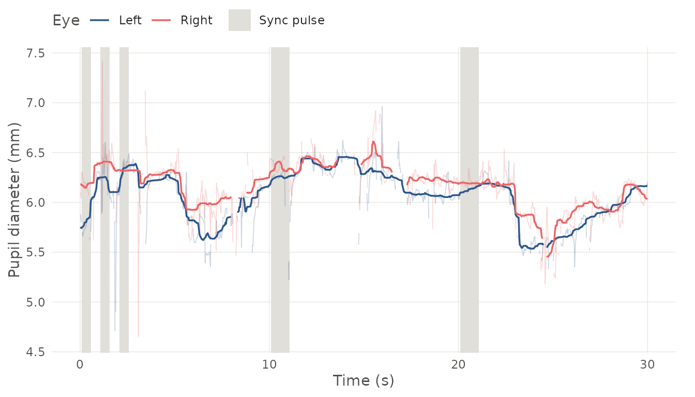
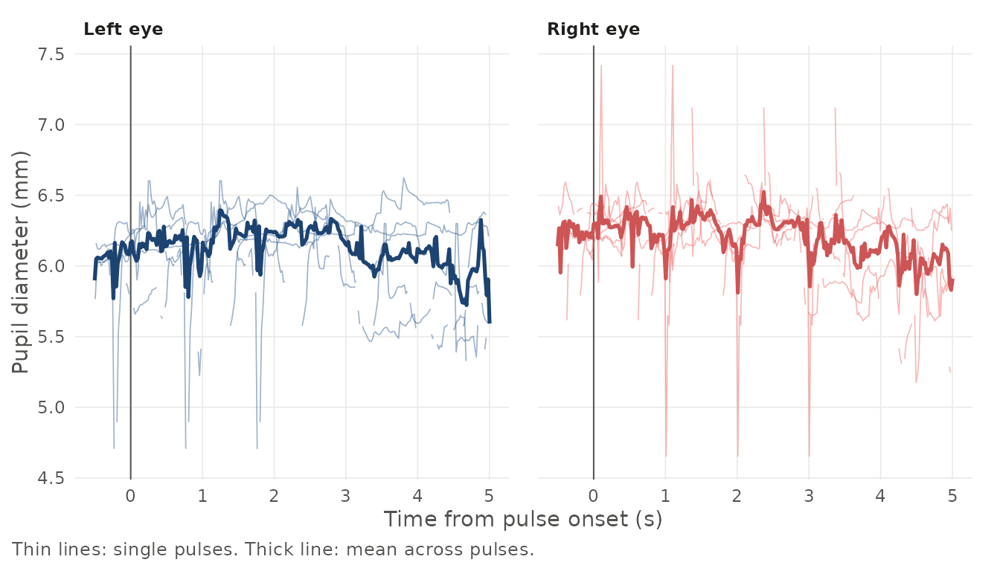

# Getting started with glasses3

The Tobii Pro Glasses 3 save each recording as a folder on the SD card.
Inside are the scene video, a metadata file called `recording.g3` and
three gzipped JSON files with one record per line: `gazedata.gz`,
`imudata.gz` and `eventdata.gz`. glasses3 reads these files directly,
without going through Tobii Pro Lab. The data come back as tibbles, so
this guide also loads dplyr to work with them.

``` r

library(glasses3)
library(dplyr, warn.conflicts = FALSE)
```

## Reading a recording

[`read_g3()`](https://mcanzi.de/glasses3/reference/read_g3.md) takes the
path to a recording folder. The package includes the first 30 seconds of
a recording, with the identifying metadata replaced by placeholders.

``` r

rec <- read_g3(g3_example())
rec
#> Tobii Pro Glasses 3 recording
#>   Name:        Example recording
#>   Participant: example
#>   Created:     2025-01-01 12:00:00 UTC
#>   Duration:    30.0 s
#>   Gaze:        1497 samples, 90.7% valid
#>   Firmware:    1.14.5+nudelsoppa
#>   Sampling:    50 Hz
#>   $gaze      1497 rows
#>   $imu       3835 rows
#>   $events    10 rows
```

The result is a list with the metadata and a tibble for each stream. The
gaze data have one row per sample. Samples where the glasses lost the
eyes keep their row, with `NA` values.

``` r

names(rec$gaze)
#>  [1] "recording"         "time"              "gaze2d_x"         
#>  [4] "gaze2d_y"          "gaze3d_x"          "gaze3d_y"         
#>  [7] "gaze3d_z"          "left_origin_x"     "left_origin_y"    
#> [10] "left_origin_z"     "left_direction_x"  "left_direction_y" 
#> [13] "left_direction_z"  "left_pupil"        "right_origin_x"   
#> [16] "right_origin_y"    "right_origin_z"    "right_direction_x"
#> [19] "right_direction_y" "right_direction_z" "right_pupil"      
#> [22] "valid_left"        "valid_right"       "valid"
summary(rec)
#> Duration: 30.0 s, 1497 samples at 50 Hz (largest gap 0.020 s)
#> Valid: 90.7% gaze point, 84.8% left, 80.3% right
#> Left pupil (mm):
#>    Min. 1st Qu.  Median    Mean 3rd Qu.    Max.     NAs 
#>   4.706   5.886   6.117   6.067   6.264   6.963     228 
#> Right pupil (mm):
#>    Min. 1st Qu.  Median    Mean 3rd Qu.    Max.     NAs 
#>   4.629   6.001   6.192   6.152   6.312   7.419     295 
#> Sync port pulses (out): 5
```

The `valid` column says whether a sample has a gaze point. The glasses
can estimate gaze from one eye, so a sample can be valid while one of
`valid_left` and `valid_right` is `FALSE`.

## Several recordings

[`list_g3_recordings()`](https://mcanzi.de/glasses3/reference/list_g3_recordings.md)
searches a folder, such as the root of an SD card, and lists every
recording it finds with its name, participant, start time and duration.
The readers
[`read_g3_gaze()`](https://mcanzi.de/glasses3/reference/read_g3_gaze.md),
[`read_g3_imu()`](https://mcanzi.de/glasses3/reference/read_g3_imu.md)
and
[`read_g3_events()`](https://mcanzi.de/glasses3/reference/read_g3_events.md)
accept this list, or a vector of paths, and stack the recordings into
one tibble. The `recording` column says which folder each row comes
from.

``` r

recordings <- list_g3_recordings(dirname(g3_example()))
recordings
#> # A tibble: 1 × 6
#>   recording path                  name  participant created             duration
#>   <chr>     <chr>                 <chr> <chr>       <dttm>                 <dbl>
#> 1 recording /home/runner/work/_t… Exam… example     2025-01-01 12:00:00       30
gaze <- read_g3_gaze(recordings)
events <- read_g3_events(recordings)
```

The functions for sync port pulses and epochs below work on such data
too. They match the samples of each recording to that recording’s
pulses, and the plots draw one panel per recording.

## Pupil diameter

``` r

plot_g3_pupil(rec)
```


The grey areas mark sync port pulses. The sync port connects the glasses
to other equipment. A stimulus computer can send a pulse at each
stimulus onset, or the glasses can send pulses that another device
records.
[`g3_syncport()`](https://mcanzi.de/glasses3/reference/g3_syncport.md)
lists the pulses with their onsets and offsets.

``` r

g3_syncport(rec$events)
#> # A tibble: 5 × 5
#>   recording pulse   onset offset duration
#>   <chr>     <int>   <dbl>  <dbl>    <dbl>
#> 1 recording     1  0.0785  0.574    0.495
#> 2 recording     2  1.07    1.57     0.499
#> 3 recording     3  2.07    2.57     0.5  
#> 4 recording     4 10.1    11.1      0.994
#> 5 recording     5 20.1    21.1      1.000
```

[`g3_add_syncport()`](https://mcanzi.de/glasses3/reference/g3_add_syncport.md)
keeps every sample and adds the sync port state, the number of the most
recent pulse and the time since its onset. This suits models of the
whole recording, where cutting epochs would drop the samples between
pulses.

``` r

tagged <- g3_add_syncport(rec$gaze, rec$events)
tagged |>
  filter(syncport == 1) |>
  select(time, pulse, pulse_time)
#> # A tibble: 173 × 3
#>      time pulse pulse_time
#>     <dbl> <int>      <dbl>
#>  1 0.0982     1     0.0197
#>  2 0.118      1     0.0397
#>  3 0.138      1     0.0597
#>  4 0.158      1     0.0798
#>  5 0.178      1     0.0998
#>  6 0.198      1     0.120 
#>  7 0.218      1     0.140 
#>  8 0.238      1     0.160 
#>  9 0.258      1     0.180 
#> 10 0.279      1     0.200 
#> # ℹ 163 more rows
```

Long recordings are hard to read at 50 samples per second. The `smooth`
argument draws a running median over the raw trace, here one second
wide. Short blinks do not pull it down, and the data themselves are not
changed.

``` r

plot_g3_pupil(rec, smooth = 1)
```



## Epochs

[`g3_epochs()`](https://mcanzi.de/glasses3/reference/g3_epochs.md) cuts
the samples into epochs around each pulse onset and adds the time
relative to the onset. After
[`g3_pupil_long()`](https://mcanzi.de/glasses3/reference/g3_pupil_long.md),
there is one row per sample and eye, which suits ggplot2 and
mixed-effects models.

``` r

ep <- g3_epochs(rec$gaze, rec$events, before = 0.5, after = 5)
pupil <- g3_pupil_long(ep)
head(pupil)
#> # A tibble: 6 × 12
#>   recording   time gaze2d_x gaze2d_y gaze3d_x gaze3d_y gaze3d_z valid pulse
#>   <chr>      <dbl>    <dbl>    <dbl>    <dbl>    <dbl>    <dbl> <lgl> <int>
#> 1 recording 0.0180    0.460    0.842     49.0    -208.     549. TRUE      1
#> 2 recording 0.0180    0.460    0.842     49.0    -208.     549. TRUE      1
#> 3 recording 0.0381    0.457    0.846     58.0    -237.     616. TRUE      1
#> 4 recording 0.0381    0.457    0.846     58.0    -237.     616. TRUE      1
#> 5 recording 0.0581    0.455    0.850     70.7    -279.     718. TRUE      1
#> 6 recording 0.0581    0.455    0.850     70.7    -279.     718. TRUE      1
#> # ℹ 3 more variables: epoch_time <dbl>, eye <chr>, pupil <dbl>
```

Given epochs,
[`plot_g3_pupil()`](https://mcanzi.de/glasses3/reference/plot_g3_pupil.md)
puts the time from the pulse onset on the x axis. Each eye gets its own
panel, with a thin line per pulse and the mean drawn on top.

``` r

plot_g3_pupil(ep)
```



For models of the whole time course, such as generalised additive mixed
models,
[`g3_downsample()`](https://mcanzi.de/glasses3/reference/g3_downsample.md)
averages the samples into time bins. Bins are counted from the pulse
onset, and a bin where more than half of the samples are missing is left
empty. Character columns, such as a participant or condition label, are
dropped unless you name them in `by`, and the groups of a grouped tibble
are kept.

``` r

binned <- g3_downsample(pupil, bin = 0.1)
head(binned)
#> # A tibble: 6 × 13
#>   recording pulse eye   epoch_time samples   time gaze2d_x gaze2d_y gaze3d_x
#>   <chr>     <int> <chr>      <dbl>   <dbl>  <dbl>    <dbl>    <dbl>    <dbl>
#> 1 recording     1 left        -0.1       4 0.0481    0.454    0.853     65.6
#> 2 recording     1 left         0         5 0.138     0.447    0.869    162. 
#> 3 recording     1 left         0.1       4 0.228     0.454    0.866    476. 
#> 4 recording     1 left         0.2       5 0.319     0.456    0.884    115. 
#> 5 recording     1 left         0.3       5 0.419     0.457    0.907     37.8
#> 6 recording     1 left         0.4       5 0.519     0.414    0.848    174. 
#> # ℹ 4 more variables: gaze3d_y <dbl>, gaze3d_z <dbl>, valid <dbl>, pupil <dbl>
```

glasses3 leaves pupil preprocessing to other packages. PupillometryR,
gazer and eyeris handle blink removal, interpolation and baseline
correction.

## Gaze position

[`plot_g3_gaze()`](https://mcanzi.de/glasses3/reference/plot_g3_gaze.md)
shows where the wearer looked in the scene camera image. The top of the
plot is the top of the video frame.

``` r

plot_g3_gaze(rec)
```


[`g3_gaze_angles()`](https://mcanzi.de/glasses3/reference/g3_gaze_angles.md)
turns the gaze direction of each eye into azimuth and elevation in
degrees, relative to straight ahead of the glasses, and adds the
vergence angle between the eyes. Angular velocity for detecting
fixations and saccades can be computed from these columns.

``` r

angles <- g3_gaze_angles(rec$gaze)
angles |>
  select(left_azimuth, left_elevation, vergence) |>
  summary()
#>   left_azimuth     left_elevation       vergence      
#>  Min.   :-24.647   Min.   :-23.003   Min.   : 0.3509  
#>  1st Qu.:  0.685   1st Qu.:-12.245   1st Qu.: 4.2129  
#>  Median :  2.172   Median : -7.240   Median : 5.0712  
#>  Mean   :  2.015   Mean   : -8.667   Mean   : 5.4612  
#>  3rd Qu.:  3.983   3rd Qu.: -5.307   3rd Qu.: 6.1301  
#>  Max.   : 25.299   Max.   : 18.841   Max.   :39.3296  
#>  NAs    :228       NAs    :228       NAs    :384
```

## Damaged files and gaps

A file that was cut off, for example by an interrupted copy from the SD
card, is still read. The readers skip the damaged lines, return the
intact samples and give a warning that names the skipped lines. A file
whose compressed data are damaged cannot be read and gives an error.
[`g3_fill_gaps()`](https://mcanzi.de/glasses3/reference/g3_fill_gaps.md)
then inserts empty rows where samples are missing, so the time series is
evenly spaced again before preprocessing.

``` r

filled <- g3_fill_gaps(rec$gaze)
count(filled, inserted)
#> # A tibble: 1 × 2
#>   inserted     n
#>   <lgl>    <int>
#> 1 FALSE     1497
```

## IMU data

The glasses sample the accelerometer and gyroscope together, while the
magnetometer runs separately at a lower rate. Each row of the IMU data
therefore has missing values for the sensors that were not sampled at
that moment.

``` r

head(rec$imu)
#> # A tibble: 6 × 11
#>   recording    time accel_x accel_y accel_z gyro_x gyro_y gyro_z mag_x mag_y
#>   <chr>       <dbl>   <dbl>   <dbl>   <dbl>  <dbl>  <dbl>  <dbl> <dbl> <dbl>
#> 1 recording 0.00338  NA       NA      NA      NA    NA      NA   -12.5  31.9
#> 2 recording 0.0119   -0.462   -9.96   -1.69  -17.0  -3.84  -25.3  NA    NA  
#> 3 recording 0.0204   -0.527   -9.94   -1.64  -17.6  -4.05  -24.7  NA    NA  
#> 4 recording 0.0288   -0.607   -9.87   -1.55  -18.0  -4.37  -24.1  NA    NA  
#> 5 recording 0.0373   -0.678   -9.83   -1.52  -18.2  -4.80  -23.3  NA    NA  
#> 6 recording 0.0457   -0.722   -9.82   -1.48  -18.4  -5.35  -22.2  NA    NA  
#> # ℹ 1 more variable: mag_z <dbl>
```
